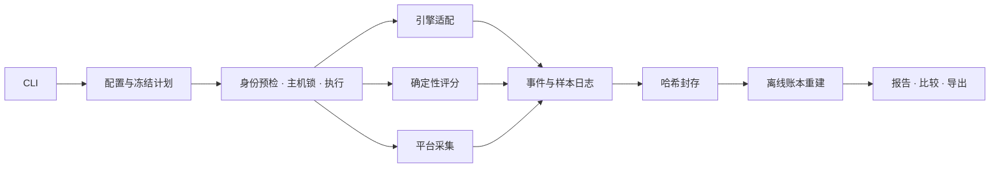

# 架构总览

本文属于 [当前架构](architecture.md)。

## 一条证据通路

| 层                | 责任与边界                                                                                            |
| ----------------- | ----------------------------------------------------------------------------------------------------- |
| CLI / 配置 / 计划 | 校验参数、解析路径和凭据引用，冻结任务顺序与预算；stdout 输出 JSON（设备检测默认摘要），诊断走 stderr |
| 契约              | 一个版本常量、一个 kind 注册表和一套结构/语义入口；Schema 合法不替代跨记录校验                        |
| 执行              | 单次配置编译为一个 workload、一个 trial；显式计划执行多轮实验，共用 Journal 与 ledger                 |
| 适配器            | 核验固定引擎能力，解析普通/流式响应、用量、结束及空闲证据；不管理外部服务生命周期                     |
| 评分器            | 以冻结题目、答案与政策做纯计算；不调用模型裁判，不访问网络                                            |
| 采集器            | 按来源和窗口输出样本及缺测原因，不改变答案质量；平台能力独立声明                                      |
| 存储              | 凭据脱敏、追加日志、刷盘、原子快照和封存；文件证据为事实源                                            |
| 离线              | 从保存事件和评分重建账本，校验来源后生成报告与比较；索引、汇总、HTML 可重新生成                       |

活动源码位于 `src/inferyard/`。本机 `validation/` 源码快照仅用于追溯，不随 Git 工作树或发行包交付。Windows 单次及受支持的批量 CPU/CUDA 通路保留进程身份、锁与原生内存采集。macOS 单次和批量共用请求生命周期，通过平台工厂选择原生身份与 `macos-resource.v1` 采集器；Linux `/proc` 采集不进入其他平台的原生通路。实现与验收范围见 [macOS 说明](../MACOS.md)。

## 源码领域包

| 包                                 | 责任                                                                |
| ---------------------------------- | ------------------------------------------------------------------- |
| `cli/`、`application/`             | 参数、请求构造、输出呈现与错误映射；共享请求/结果类型及延迟命令分派 |
| `contracts/`、`config/`            | 唯一结构/语义契约；配置、题包、冻结计划与声明绑定                   |
| `runtime/`、`evidence/`            | 请求、取消、排空与安全控制；日志、封存、账本、当前格式核验与旧格式拒绝 |
| `analysis/`、`reporting/`          | 评分、指标和比较计算；离线报告、重评分与导出                        |
| `platforms/`、`extensions/`        | 设备与进程身份、平台采集；独立扩展协议及执行工作流                  |
| `adapters/`、`data/`、`templates/` | 引擎传输和解析；随安装包交付的方法/指标目录与报告模板               |

`registry.py` 和 `provenance.py` 位于根包，分别管理目录注册和源码身份。

## CLI 与应用边界

- `main(argv=None, *, handlers=None) -> int` 是控制台和模块入口。CLI 负责参数、输入校验、请求构造和输出呈现；业务执行器返回结果，不向 stdout 写诊断。`device-check` 默认人类摘要，显式 JSON 保留既有结果外层，其他命令仍为 JSON；格式参数不进入应用请求。
- `CommandRequest`、`CommandResult`、`Handler` 只定义在 `application/types.py`；业务模块不依赖 CLI，CLI 重导出同一对象。
- `--help`、`--versions` 和 `--schema` 只注册参数及读取元数据，不加载实时后端。Schema 注册表只依赖契约包与版本常量；语义验证在解析时调用。
- 应用分派显式覆盖注册命令，未知请求拒绝。`run --plan` 和 `resume` 进入批量路径，单次运行与专项命令进入各自处理器。
- 规范命令适配到已有业务动作。旧命令名和参数别名已删除。`application/verification.py` 识别产物并延迟调用专用验证器；CLI 不复制其验证逻辑。
- 入口统一映射输入、预检、证据、IO、内部异常与取消；退出码保持 0/2/3/4/130，stderr 不回显凭据。

安装包包含所有领域包、`data/` 和 `templates/`；模板和 catalogue 从包内资源读取，不能依赖源码检出目录。完整包摘要保留来源；新运行另按 measurement/scoring/presentation 清单记录职责身份，旧证据按保存版本解释。具体清单与依赖边界见[职责身份契约](contracts/scoped-measurement-contract.md)。

