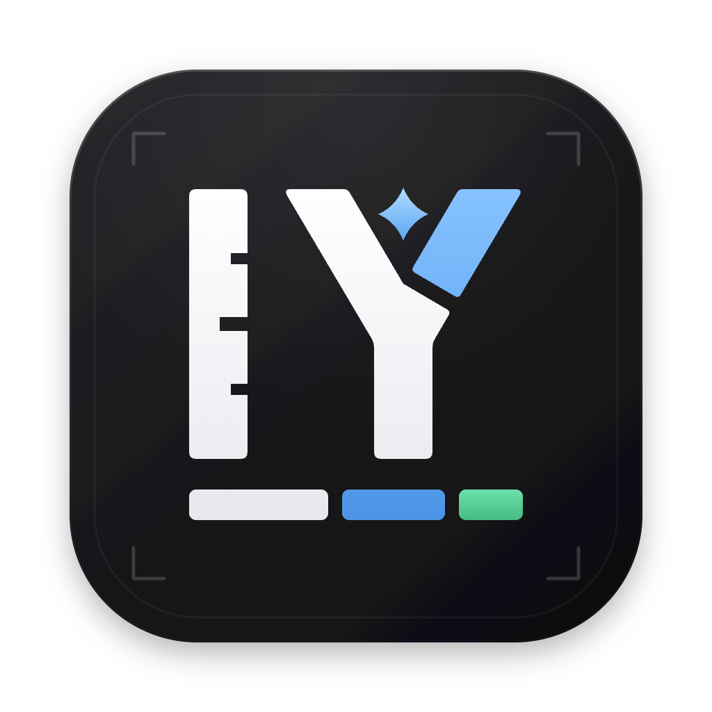

<p align="left">
  
</p>

# InferYard Studio

InferYard Studio is a native Go (`1.27.3`) desktop app built on [onevra](https://github.com/oneo-me/onevra) UI components and MyGo `v0.10.0`. Pages call `core.Service` in-process and invoke the [CLI subproject](../cli/README.md) (`inferyard`) for benchmark execution and `studio.json` report generation.

## Pages and first launch

On macOS, open the downloaded `.dmg` from [Releases](https://github.com/sunny0826/inferyard/releases/latest), drag `InferYard Studio.app` into `Applications`, and clear the quarantine attribute before first launch (the release build is unsigned):

```sh
xattr -dr com.apple.quarantine /Applications/InferYard\ Studio.app
```

1. On first launch (**Services**), choose **Prepare Environment** to set up or reuse `uv` (`>= 0.13.6`), `inferyard`, and the unified workspace directory (`~/.inferyard/workspace`, storing `results/`, `models/`, `engines/`, and `reports/`). After upgrading Studio, an outdated CLI is upgraded automatically in the background, and an error banner is shown only if the CLI upgrade fails.
2. If local assets are missing, open **Library** to inspect your hardware summary and follow the hardware-aware starter recommendation (one-click guided **PolyStrata** setup with 4-stage progress/recovery on supported Apple Silicon, NVIDIA CUDA, or AMD ROCm hardware, or switch to lightweight `llama.cpp` + GGUF), browse the **Models** / **Engines** tabs, or configure an existing local engine.
3. On **Services**, inspect or start your managed local model service and other discovered local services. Click **Benchmark Service** (or open **Benchmarks** / click `+` beside **Benchmarks**) to select an engine, model, and task sets (`zh-core` + `zh-svg-pelican` by default, or switch to **Long-Context Speed** / `zh-context-speed` for 64K / 128K / 256K), then click **Start Benchmark**. Studio manages local services it launches and stops them on exit, or binds a running local service after PID/identity checks.
4. Click **View Report** when finished, or navigate between the views in the sidebar (with live service, benchmark queue, download status, and **Settings** docked at the bottom; the notification bell and update badge sit in the top-right header bar):

| View | What it provides |
| --- | --- |
| **Benchmarks** (`+`) | **Active & Recent** (**In Progress** / **Queued** / **Recently Completed** merged with recent reports and historical runs, with per-task exclusivity badges) and **Run History** tabs (search/status filterable table + right-hand **Run Details** drawer for one-click report viewing/creation, rerun with same config, and batch resume), **New Benchmark** launcher for standard bundles & **Long-Context Speed** (`zh-context-speed`: 64K / 128K / 256K), 6-step benchmark progress & live **Resource Curves** |
| **Services** *(default)* | Parallel multi-service management with independent **Start Model** launcher, remembered per-`(Model, Engine)` launch presets (**Recently Launched**, fixed/auto port with conflict detection, real-time memory budget estimation that blocks over-allocation, opt-in **Allow LAN access (`0.0.0.0`)** toggle with security notice, and collapsible advanced GPU/CPU/CLI args), collapsible managed service cards (4-tile status with live measured RSS vs. estimated memory, inline best benchmark throughput & report link, **Adopted** and **LAN Exposed** badges, pre-benchmark external connection detection dialog with dedicated-instance memory check, one-click endpoint copy, **Usage Examples** drawer with `curl`/`Python`/`Environment` snippets & live `/chat/completions` connectivity probe, Web UI & per-service logs access, independent confirmed stop), multi-notice red **Unexpected Exit** alert cards (with log tail, OOM hint, and per-card restart/adjust/dismiss), sidebar multi-service quick popover, quit confirmation dialog, and discovery of other local OpenAI-compatible services |
| **Library** | Collapsible **This Machine** hardware readiness & recommendation card (`device-check`), active download progress, and **Models** / **Engines** tabs combining multi-root model management, benchmark evidence backflow (best measured throughput per model with multi-engine comparison & direct report link), automatic upstream engine version update checks (6-hour cache, manual refresh, notification center summaries) with one-click updates (`llama.cpp`, `PolyStrata`, Python venv engines), one-click **Standalone Model Serving** (launch a local OpenAI-compatible service with custom context length without creating a benchmark task), local engine setup wizard, safe uninstall, and multi-engine/model download catalogs (`PolyStrata`, `llama.cpp`, `mlx-lm`, `vLLM`, `SGLang`, `LM Studio`, Hugging Face & ModelScope mirrors) |
| **Reports** | Model-grouped `studio.json` **Benchmark Reports** with exclusivity badges (**Exclusive** / **External connections** / **Not checked**), sandboxed animated SVG showcase (with source view), quality/latency/throughput/resource breakdowns, **Long-Context Speed** results, and filterable **Run History** with **Run Details** drawer |
| **Settings** *(sidebar footer)* | **General** tab (**Appearance** `Light` / `Dark` / `Follow System` with live visual previews, **Language** `Follow System` / `English` / `简体中文`, **System Tray** & **Keep local services running on quit** toggle, **Workspace Directory** single unified root for `results/`, `models/`, `engines/`, and `reports/` with **Clean Benchmark Artifacts** action that clears runs/configs/reports while preserving models, engines, and device checks, **Existing Local Engines**, **Network & Proxy** scoped HTTP(S) download proxy, and **Software Update** automatic GitHub Releases check & one-click SHA-256 verified self-update) and **About** tab (app version, build time, Git commit ID, and copy action) |

## Internationalization (i18n)

Studio ships with full **English** (`en`) and **Simplified Chinese** (`zh-Hans`) catalogs powered by `mygo/i18n` and embedded JSON resources in `studio/internal/l10n`:

- **Live switching:** Open **Settings → Language** and choose **Follow System**, **English**, or **简体中文**. Labels, navigation, notifications, and tray items update immediately without restarting Studio.
- **Environment override:** Set `MYGO_LOCALE=en` or `MYGO_LOCALE=zh-Hans` when launching Studio to override the resolved locale.
- **UI debug language preview:** `--debug-ui` mode supports switching languages live alongside scenario presets.
- **macOS bundle localization:** Packaged `.app` bundles include `en.lproj` and `zh-Hans.lproj` (`CFBundleLocalizations`) so macOS system menus and dialogs follow the selected locale.

## Build and run

For paired checkout development (builds both CLI and Studio into an isolated `.inferyard-dev/` profile), run from the repository root (see [tools/README.md](../tools/README.md)):

```sh
mise run dev
```

To build Studio directly from `studio/`:

```sh
mise exec -- env GOTOOLCHAIN=go1.27.3 GOPROXY=https://goproxy.cn,direct CGO_ENABLED=0 go build -o build/inferyard-studio .
./build/inferyard-studio
```

To cross-build unsigned distributions (`darwin-arm64`, `windows-amd64`, `linux-amd64`) into `dist/`:

```sh
mise exec -- env GOTOOLCHAIN=go1.27.3 GOPROXY=https://goproxy.cn,direct sh scripts/build-all.sh
```

Formal release artifacts (`.dmg`, Inno Setup `.exe`, `.tar.gz`) are built natively with `-tags release` by [release.yml](../.github/workflows/release.yml). App version metadata lives in [mygo.config.ts](mygo.config.ts). Settings are stored under `InferYard Studio/settings.json` in the OS user configuration directory.

## UI debug preview

Open simulated native pages without touching `core.Service`, user settings, or model processes (available only in `ui_debug && !release` builds; formal release builds reject `--debug-ui`):

```sh
mise exec -- go run -tags ui_debug . --debug-ui
```

Use the sidebar scenario selector to jump to a starting state, switch UI languages live, or drive workflows end-to-end through normal page controls.

## Verification

Preferred root-level `mise` tasks (run from the repository root):

```sh
mise run test:studio                 # Studio Go unit tests (macOS)
mise run test:studio:preview         # UI debug preview Go tests (macOS)
mise run test:studio:e2e             # Boundary E2E with synced CLI (cross-platform)
mise run test:studio:e2e:polystrata  # Real-machine PolyStrata lifecycle E2E (opt-in, uses local assets)
mise run test:studio-ui              # macOS native UI E2E: daily 3 workflows
mise run test:studio-ui:full         # macOS native UI E2E: all 7 workflows
mise run test:studio-ui:polystrata   # Local-only real-window PolyStrata UI E2E (not run in CI)
```

Additional direct checks from `studio/`:

```sh
mise exec -- env GOTOOLCHAIN=go1.27.3 GOPROXY=https://goproxy.cn,direct CGO_ENABLED=0 go test -tags ui_debug,release . -count=1
mise exec -- python -m unittest discover -s scripts -p 'test_*.py'
mise exec -- python -m unittest discover -s tests/ui -p 'test_*.py'
```

- Boundary E2E (`tests/e2e`) runs the real CLI against a fake engine; see [tests/e2e/README.md](tests/e2e/README.md).
- macOS native window E2E drives XCUITest against `--debug-ui`; see [tests/ui/README.md](tests/ui/README.md).
